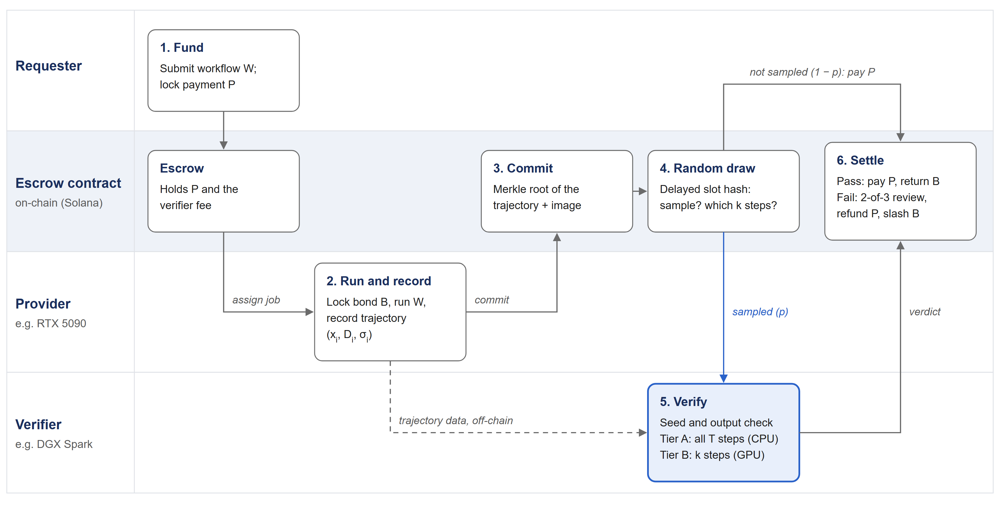

# Verifying Rented GPU Work: A Primer on the Trajectory Verification Paper

Nov 23, 2026 · Dito Eka Cahya

> Copied from the Claude Docs version at https://claude.ai/artifact/2tdHdLtt8rjTi93nax1ZrK (revision 13). That online doc was the master when this copy was made, so if the two differ, update this file from it.

## Summary

The paper asks one question: when you pay a stranger's GPU to generate an image, how cheaply can you check that they did the work you paid for? Its answer is a protocol and a study. The protocol makes the provider record every step of the image-generation process and lets a verifier re-check a few random steps for a few percent of the original cost. The study measures whether such checks can tell real cheating apart from the harmless numerical noise that different GPUs produce.

The target venue is the *Emerging Science Journal* (Q1). The manuscript is fully drafted, but **no experiments have run yet**: every result in it is a placeholder that the engineering work will fill. This document explains the paper and the background needed to follow it, for an engineer who is not a blockchain or verification specialist.

## Background 1: decentralized GPU marketplaces

A decentralized GPU marketplace lets anyone with an idle graphics card rent it out to strangers who need AI compute. Networks such as Render, Akash and io.net do this today, and the broader category is called DePIN (decentralized physical infrastructure networks). Research systems such as Petals have shown that inference and training can work over consumer GPUs scattered across the internet.

The weak point is trust. In a cloud such as AWS you trust one company. In a marketplace the provider is an anonymous person paid per job, who earns more by doing less work. Nothing in the job's output proves which model ran, for how many steps, or at what precision.

This is an old problem. Volunteer computing projects such as SETI@home and BOINC in the early 2000s found that some volunteers returned fake results to climb leaderboards. Their defences are the ancestors of this paper: run the same task twice, plant tasks with known answers, and spot-check a random fraction of results.

## Background 2: blockchain, smart contracts and escrow

A blockchain is best thought of as a shared database that no single party controls. Many independent computers keep copies of the data and agree on every new entry, so nobody can quietly edit history. The paper uses Solana, a fast blockchain where a transaction settles in well under a minute and costs a fraction of a cent.

A **smart contract** is a small program stored on the blockchain. Anyone can call it, and its rules run exactly as written. The paper uses one as an **escrow**: the buyer deposits payment before the job starts, and the contract releases it to the provider or refunds the buyer according to recorded verdicts. The provider can also post a **bond**, a deposit it loses if caught cheating. A timeout refunds the buyer if the job stalls, so no company has to hold the money.

The key limitation is what a chain can prove. It can prove that money moved, that a provider published a fingerprint (hash) of its result at a certain time, and that a verdict was recorded. It **cannot** see the computation, which happens off-chain on the provider's GPU. So the blockchain handles *payment and accountability*, and a separate mechanism must check *the work itself*. That mechanism is the paper's subject.

One more building block is a **commitment**. The provider publishes a short hash (a SHA-256 fingerprint) of its data before anyone checks it. Changing the data afterwards would change the hash, so the provider is locked in. The paper commits to a whole sequence of tensors with a **Merkle root**, a single hash built from a tree of hashes. Any individual piece can later be shown to belong to the committed set.

## Background 3: how a diffusion model makes an image

A diffusion model, such as Stable Diffusion or SDXL, builds an image by removing noise step by step. The whole process is deterministic once the seed and settings are fixed, which is what makes checking possible:

1. **Start from noise.** A random-number generator seeded with the job's **seed** produces a block of pure noise, the starting **latent** (a compressed 128 × 128 × 4 array for SDXL, not pixels). In ComfyUI this noise is generated on the CPU, so anyone with the seed can recreate it exactly.
2. **Denoise in T steps.** At each step the neural network (the **UNet**) looks at the current latent and the prompt and predicts what the clean image should look like. A small fixed formula, the **sampler** (for example Euler or DPM-Solver++), moves the latent a little toward that prediction. A typical job uses T = 30 steps, and the network call is almost all of the cost.
3. **Decode.** A final network (the **VAE decoder**) turns the last latent into the image.

The sequence of latents from noise to final image is the **trajectory**. This is the central object in the paper. ComfyUI, the open-source workflow engine the paper targets, exposes each step's latent and prediction through a callback, so a provider can record the full trajectory without modifying the model.

## Background 4: why two GPUs never agree exactly

Run the same job with the same seed on two different GPUs and you usually get images that look identical but differ in the last bits. Floating-point addition is not associative: (a + b) + c can differ slightly from a + (b + c). GPUs add millions of numbers in parallel, and the order depends on the chip, the driver, the library version and the attention implementation. Tiny rounding differences then grow over 30 denoising steps.

This matters because the naive check, “re-run the job and compare hashes”, would reject almost every honest provider whose GPU differs from the verifier's. Every practical check therefore needs a **tolerance**: how different two results may be and still count as the same. The tolerance is a double-edged choice. Too tight and honest providers are falsely rejected (a **false positive**). Too loose and cheaters slip through (a **false negative**). Choosing it from measured data, rather than guessing, is a large part of the paper.

## Background 5: ways to check someone else's computation

There are four broad ways to verify work done on someone else's machine. They trade cost against how much you must trust or control. The paper sits in the last row: cheap, needs no special hardware, but only probabilistic.

| Approach | How it works | Cost | What it needs | Fit for a GPU marketplace |
| --- | --- | --- | --- | --- |
| Cryptographic proofs (zero-knowledge) | The provider attaches a mathematical proof that the computation was correct | Minutes to an hour per inference; about an hour for a small diffusion model | Specialized proving systems | Too slow and costly today |
| Trusted hardware (TEE) | A sealed enclave on the provider's machine attests to what ran | Moderate slowdown | Trusted hardware on every provider | Most consumer GPU owners lack it |
| Full re-execution | A verifier re-runs the whole job and compares | Doubles the cost of each checked job | A tolerance for GPU noise | Works, but expensive |
| Spot checks (sampling) | Re-check only a random fraction of jobs, or of steps within a job | A small fraction of the job | A tolerance, plus penalties large enough to deter | The paper's approach |

Spot checks rest on a simple idea. If each job is checked with probability p, a provider that cheats on many jobs is caught eventually, and a large enough penalty makes cheating a losing bet. The paper takes this idea one level deeper: within a checked job, it re-runs only k randomly chosen *steps* instead of the whole job.

## The cheating problem

The dangerous cheats are not garbage outputs, which are easy to catch, but **cost-saving** shortcuts that still produce a plausible image. Each saves GPU time while looking almost like honest work:

| Attack | What the provider does | Why it is hard to catch from the image |
| --- | --- | --- |
| Fewer steps | Runs 20 or 15 steps instead of 30 | The image looks nearly the same |
| Quantized model | Runs the network in 8-bit (fp8) instead of 16-bit; one ComfyUI flag on current GPUs | Differences are small, possibly within GPU noise |
| Distilled “turbo” model | Swaps in a model built to finish in 1–4 steps | Same composition, slightly different detail |
| Early exit | Stops partway and guesses the rest | Final image is blurry only in fine detail |
| Low resolution + upscale | Generates small, then enlarges | Looks fine at a glance |
| Forged trajectory | Computes a few steps and fakes the recorded ones in between | Only detectable if the faked steps are inspected |

For language models, research has already shown that output-only checks cannot reliably detect a quantized substitute: classifiers did no better than chance. Nobody has measured this for diffusion. If honest cross-GPU noise is as large as the effect of fp8, an output-only check cannot tell them apart, however many jobs it samples.

## The paper's approach

The protocol makes the provider record the whole trajectory and lock it in with a commitment. A verifier then checks a randomly chosen job cheaply: arithmetic on every step, and a real network re-run on only k of the 30 steps.



*The online doc shows an interactive diagram here. This copy uses the manuscript's Figure 2, which shows the same lifecycle.*

Most jobs are never checked and cost nothing extra. A checked job runs three kinds of check:

- **Seed and output binding.** The verifier regenerates the starting noise from the seed and requires an exact match, then decodes the final latent and requires it to match the delivered image.
- **Tier A, solver consistency.** Each step's next latent is a fixed formula of the current latent and the network's prediction. The verifier recomputes that formula for all 30 steps on a CPU, which costs essentially nothing. It catches copied, interpolated or truncated trajectories and a wrong number of steps.
- **Tier B, model consistency.** A clever forger can fake the network's predictions so that the arithmetic still adds up. To catch that, the verifier re-runs the actual network at k random steps and compares with a tolerance calibrated separately for each step. With k = 3 out of 30 this costs roughly a tenth of re-running the whole job.

The paper compares this design (called E2-H) with full re-execution (E0) and with faithful copies of two rules used by real decentralized networks today (E0-N and E2-W). The blockchain's role is narrow: hold the payment and bond, record the commitment and verdicts, and pay out or refund automatically.

## The theory in plain words

The paper proves three short results. Each ties a protocol choice to a number the experiments will measure.

**1. Output-only checks have a ceiling.** If cheated images and honest images (including GPU noise) are statistically similar, no rule that only looks at the image can catch the cheat much more often than it falsely rejects honest work. Checking more jobs does not help, because each check is equally blind. Formally, detection ≤ false-rejection rate + the total-variation distance between the two output distributions:

```math
q_A \le \alpha + \mathrm{TV}(\mathcal{D}_A, \mathcal{D}_H)
```

**2. Spot-check odds.** If a provider fakes a fraction s of the steps and the verifier checks k random steps, the chance of catching it is roughly 1 − (1 − s)^k when every faked step is detectable. Faking half the steps with k = 3 is caught about 7 times in 8. A practical catch: checking more steps also multiplies the chance of a false alarm, so the per-step tolerance must tighten as k grows. For a 1% job-level false-alarm budget and k = 3, each step may misfire at most about 0.33% of the time.

**3. Cheat fully or not at all.** Compare what a provider saves by faking a fraction s of steps with what it expects to lose (payment plus bond, times the chance of being caught). The paper shows that this gain is convex in s, so the best strategy is always at an extreme: be honest or cheat on everything. That gives one clean condition for deterrence:

```math
p \, [1 - (1 - r_A)^k - \alpha(k)] \, (P + B) \ \ge\ \beta_A \, c
```

In words: sampling rate × net catch probability × (payment + bond) must exceed the GPU cost the attack saves. The marketplace can then choose the cheapest sampling rate p and number of checked steps k that satisfy this for every attack. If some attack is indistinguishable from honest noise (r_A close to the false-alarm rate), no p or k works, and the paper will say so.

## The experiments

The study asks three research questions, designed so that each produces a useful answer whatever the data shows:

1. **RQ1, characterize:** how much do honest outputs differ across GPUs and software settings, at the image, the per-step latent and the single step?
2. **RQ2, separate:** with false alarms held at 1% or less, which attacks can each kind of check detect, and do the deployed rules catch them?
3. **RQ3, price:** what verifier GPU time, blockchain fees and latency does a given deterrence target cost?

**Hardware.** The team owns at least two RTX 5080 GPUs (consumer cards, x86 hosts) and at least two NVIDIA DGX Spark systems (ARM processor, 128 GB unified memory). Both are the same GPU generation (Blackwell), so a few older GPUs are rented briefly. Differences are measured at five nested levels, each isolating one cause:

| Level | Compared | Isolates |
| --- | --- | --- |
| L0 | Same GPU, run twice | Run-to-run randomness |
| L1 | Same GPU, different settings | Precision, attention code, library versions |
| L2 | Two cards of the same model | Unit-to-unit differences |
| L3 | RTX 5080 vs DGX Spark | Chip, memory system, x86 vs ARM CPU |
| L4 | Blackwell vs older rented GPUs | GPU generation |

**Workloads and attacks.** SD1.5 and SDXL workflows in ComfyUI, with prompts split into calibration, development and test sets. All the attacks in the table above are run, plus four ways of forging a trajectory. Tolerances are chosen on calibration data and frozen, with a recorded hash, *before* any attack data is looked at, so the results cannot be tuned after the fact.

**What the results will look like.** Tables of detection rate per attack and per check type, at a fixed 1% false-alarm rate with confidence intervals; plots of honest deviation per GPU pair and per step; and a cost-versus-detection curve. Every number will come from a logged run; none exists yet.

## What is new, and what is not

The paper's novelty is narrower than “first to verify decentralized AI”, and it says so. The ideas of escrow, spot checks and tolerances each already exist. What is new is combining them for diffusion workloads, calibrating them against measured GPU noise, and testing them against cost-saving cheats.

| Closest work | What it does | What it leaves open |
| --- | --- | --- |
| [TAO](https://doi.org/10.1145/3767295.3803612) (EuroSys 2026) | Tolerance-aware verification with on-chain bonds and audits, calibrated per operator across 4 GPU models | Needs deep access to the model's internals; diffusion only in a cost table; quantization and early exit explicitly out of scope |
| Kim et al. (2023, preprint) | Measured how much Stable Diffusion outputs differ across 22 GPUs | No attacker, no payments, no cost |
| Bittensor subnets 23 and 30 (deployed) | Real networks already validate images: one by full re-generation, one by spot-checking 3 steps | Thresholds picked without calibration and never tested against attacks |
| [Proof-of-learning](https://doi.org/10.1109/SP40001.2021.00106) (IEEE S&P 2021) | Re-checks selected steps of a committed *training* run with a noise tolerance | Training, not image generation; no cost-saving substitution |
| Volunteer computing (BOINC, Sarmenta 2002) | Spot checks and redundancy against cheating volunteers | Assumes re-running gives exactly the same answer, which GPUs do not |

The deployed Bittensor rule matters most for framing. Per-step spot checking is already running in production with a loose, uncalibrated threshold, so the paper is framed as *break and fix*. First it tests whether the deployed rules accept cheap forgeries; then it proposes the calibrated, hardened version.

## Status, limitations and glossary

**Status.** The manuscript is written in the journal's Word template with 59 verified references; results are placeholders. An engineer runs the experiments from a step-by-step runbook, starting with a short hardware pilot; submission is targeted for mid-May 2027.

**Limitations the paper states openly:**

- Verifiers are assumed honest and not colluding with providers.
- Only deterministic samplers are covered; samplers that add fresh random noise each step draw it on the GPU and need extra work.
- Cross-generation results cover only the GPU models actually tested.
- A check proves the result is consistent with the requested job, not that a particular physical GPU ran it.
- Some attacks, especially 8-bit quantization, may turn out impossible to separate from honest noise. That would be reported as a finding, not hidden.

**Glossary**

| Term | Meaning |
| --- | --- |
| Bond | Money a provider deposits and loses if caught cheating |
| Commitment | A hash published in advance that locks the provider to its data |
| DePIN | Decentralized physical infrastructure network: hardware pooled through a blockchain |
| Escrow | A contract that holds payment until conditions are met |
| False positive / negative | Honest work rejected / cheating accepted |
| Latent | The compressed internal array a diffusion model works on before decoding to pixels |
| Merkle root | One hash summarizing many pieces of data, any of which can later be proven included |
| Sampler | The fixed formula that moves the latent one step closer to the image |
| Seed | The number that fixes the starting noise |
| Spot check | Re-checking only a random sample of jobs or steps |
| Tier A / Tier B | The cheap arithmetic check on every step / the network re-run on k random steps |
| Tolerance | How much two results may differ and still count as the same |
| Trajectory | The full sequence of latents from noise to final image |
| UNet | The neural network that predicts the clean image at each step |
